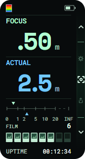

# 当前竖屏 UI

2026-10-19。HOME 取消时域曲线，改为上下两块距离读数；右侧栏沿用原位置、图标和按键逻辑。设计输入为 [home.svg](home.svg)，预览为 [home.png](home.png)。

| 区域 | 字体 / 坐标 | 说明 |
| --- | --- | --- |
| 顶部 | 五色标记 (12,9)、电池 (131,11) | 不显示 PolaMiya 文字 |
| FOCUS / ACTUAL | Roboto Mono 14 px，基线 47/131 | 上对焦、下实测 |
| 距离数值 | Space Mono Bold 48 px，基线 100/184 | 数字步距 29 px；小数点步距 12 px，位图在格内居中 |
| m 单位 | Roboto Mono 16 px | 跟随数值，间隔 6 px；整组在 132 px 宽区域居中 |
| INF / NEAR / 横杠 | Roboto Mono 30 px | 居中，不显示单位 |
| 即时距离标尺 | 水平线 y=218.5，标签基线 243 | 对数有限轴 0–20 m，独立 INF，双指针对应两组读数 |
| FILM | 标签与数量基线 258，相纸 y=267–286 | 8 张相纸，当前示例为 6 张 |
| UPTIME | Roboto Mono 12 px，基线 309 | 本次运行时间 |

数值保持 `.xxm` / 一位小数 / 整数米格式；小数点不占完整数字格。代码中的控件坐标、字形指标与预览一致，移除了 lv_chart、101 点历史缓存和定时采样接口。

侧栏宽 17 px、x=155，背景 y=20–299；分隔线 y=84/236，KEY3/KEY2/KEY1 图标中心 y=54/160/266。HOME 功能轮换为 SETTINGS → FOCUS → EJECT → INFO，浏览时显示上一项、当前项和下一项。EJECT 启停仍使用 1 s 硬件斜坡，选中时隐藏上下导航箭头。

静态背景由导出器提取为 10 个 RGB565 窄条；侧栏、指针和亮暗相纸单独保存，不新增整屏缓冲。SVG 的 data-ui-distance、data-ui-distance-unit、data-ui-battery-fill 和 data-ui-live 标记对象属于动态预览，不进入静态图块。

开机画面为 [boot.svg](boot.svg)、[boot.png](boot.png)，本轮保留原样：白底黑狗、9 px 初始化日志和出厂 MAC。业务及启动细节见 [UI 模块](../../code/PM_Controller/main/app/ui/README.md) 和 [开机画面](../../code/PM_Controller/main/app/boot_screen/README.md)。

维护时编辑 SVG，再运行 `node export_lvgl_assets.cjs <node_modules路径> [chrome.exe路径]` 生成固件资源，用 `node render_ui.cjs <node_modules路径> [chrome.exe路径]` 更新 PNG。前者依赖 Playwright / Sharp，后者依赖 Playwright。字体只取仓库内固定版本，禁止系统字体回退；两份 OFL 1.1 许可及来源一并保留，见 [字体许可](../../code/PM_Controller/THIRD_PARTY_NOTICES.md)。

本轮已核对小数、整数及 INF 设计预览；未编译、测试、运行 LVGL 模拟器或烧录，实屏效果与性能待确认。历史布局和按键基准文件保留。
