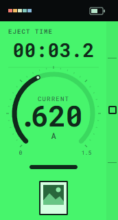

# 当前竖屏 UI

2026-11-02 用户已确认菜单方案并要求生成代码：四类菜单的统一模型、原生 LVGL 渲染和按键状态已接入 PM_Controller；当前实际注册背光、寻零和返回，ON/OFF 与 LANGUAGE 仍为样式示例。代码入口及扩展方式见 [MENU.md](../../code/PM_Controller/main/app/ui/MENU.md)。本轮未编译、运行固件测试或烧录，设计预览不代表实屏验收。

2026-11-02 设置菜单补充第四类“多选项单选子菜单”：主列表显示当前值和进入箭头；独立列表用候选高亮、当前值勾号和滚动条，确认返回，BACK 保留原值。见 [入口 → 选择 → 返回预览](proposals/2026-11-02-settings-menu/submenu-preview.png) 和 [滚动 / 返回状态](proposals/2026-11-02-settings-menu/submenu-states.png)。LANGUAGE 仅为设计示例，交互约定见该提案说明。

2026-11-02 设置菜单视觉稿：将项目整理为数值、执行和选项三类，统一卡片、选中 / 编辑 / 执行中状态及三键提示，文字最小 14 px。见 [三类菜单预览](proposals/2026-11-02-settings-menu/preview.png)、[状态预览](proposals/2026-11-02-settings-menu/states.png) 和 [交互说明](proposals/2026-11-02-settings-menu/README.md)。ON/OFF 仅为样式示例；本轮交付为设计稿，现有固件菜单行为以 UI 模块说明为准。

2026-11-02：充电不再循环填充，电池本体显示当前估算电量，左侧闪电放大至 8×14 px，主体仍为 19×10 px。HOME / EJECT 共用资源，不显示百分比数字。[充电对比预览](proposals/2026-11-02-home-readable/charging-preview.png) 展示普通、充电低电量和充电高电量三种示例；充电中填充随估算电量改变，不随时间循环。

2026-11-02 可读性：HOME 最小字号统一为用户确认的 14 px，标尺数字和 FILM 已放大；FOCUS 提示从刻度区移入卡片，使用 14 px 短文字配合 I/E/C 标记。电池只保留图标，不显示百分比。正式 SVG、静态资源和 [三状态预览](proposals/2026-11-02-home-readable/preview.png) 已同步，原尺寸图和生成入口见 [说明](proposals/2026-11-02-home-readable/README.md)。仅设计渲染与静态核对，未编译、测试或烧录。

2026-10-20 充电图标：普通电量、闪电＋循环填充、满格＋上移 1 px 对勾、空框斜杠（无电池）、橙色问号（待确认）已接 HOME 和 EJECT。原图标主体保持 19×10 px，HOME 与 EJECT 分别定位；小型 mask 设计源为 [battery-icons.svg](battery-icons.svg)，由既有导出脚本生成，HOME / EJECT 共用同一控件。状态判定见 [充电状态说明](../../code/PM_Controller/main/app/charge_status/README.md)。未编译、测试或上板验证。

2026-10-20 相纸数量接入 EEPROM：HOME 显示保存的余量，FILM_KEY 事件延时恢复成功后设为 8 并保存。一次吐片从首次启动至最终停止斜坡目标结束严格超过 5 s 才扣 1，最低 0，完成后保存；中途反向切换仍算同一次。旧记录缺少余量字段时默认 6，下方 HOME 预览仍保留示例 6 张；无界面布局变化。未编译、测试或上板验证。

2026-10-25：EJECT 启动和停止成功后直接切页，不做页面亮度渐变；电机保留 1 s 硬件斜坡。

2026-10-20 新增独立 [EJECT 设计源](eject.svg) / [预览](eject.png)：鲜绿色主体、31 px 黑色顶栏、28 px 吐片用时、42 px 电流数字和 0–1.5 A 圆环。小于 1 A 显示 `.xxx`；不显示 EJECTING 或 PRESS TO STOP。底部相纸为 42×50 px，比初版放大 1.5 倍；2.6 s 周期内从出片口下移并淡出。预览与运行页均仅显示中键停止图标。静态标题与刻度为 16 个 RGB565 窄条，动态圆环及侧栏为 LVGL 控件，动画只移动一张 ARGB 素材，无整屏图片。运行时隐藏 HOME，停止成功后直接返回，无页面渐变；现有三页导航不加入 EJECT。只生成资源和设计预览，未编译、测试或烧录。

`create_eject_design.cjs` 使用固定字体和独立顶栏生成 EJECT SVG；修改设计后运行 `node create_eject_design.cjs`，再运行既有资源导出和预览脚本。两套新增 Space Mono 字形分别为时间 28 px、电流 42 px，电流小数点步距为 10 px；现有 HOME / boot 设计不改写。

2026-10-29：HOME 使用第三版明亮配色和双距离卡，UPTIME 移至 INFO。设计输入为 [home.svg](home.svg)，预览为 [home.png](home.png)；历史提案及最新调整预览保留在 [proposals](proposals/)。

实测卡 (8,32) 120×90，对焦卡 (8,130) 120×85；距离使用 Space Mono Bold 50 px，数字步距 30 px，小数点 12.5 px，单位 Roboto Mono Bold 20 px。标尺为对数 0–20 m 加独立无穷远，底部为 FILM 数字和八格相纸。右侧浅薄荷色栏 x=136、宽 36，上、下键图标中心 y=54/266，中间图标组中心 y=164；EJECT 保留窄侧栏。INFO / SETUP 切页显示左右箭头。实屏尚未验证。

两个卡片标题均由 LVGL 使用同一个 `ui_font_home_title`（Roboto Mono Bold 16 px）绘制，避免标题使用不同绘制路径。HOME 电池主体移至 x=143，靠屏幕右上；侧栏不再显示功能名称、DONE 或步长文字，中键色块高 44 px。

静态图块由导出器按 `data-ui-live` 标记过滤动态预览并生成；侧栏由 LVGL 绘制，指针和相纸单独保存，不新增整屏缓冲。

开机画面为 [boot.svg](boot.svg)、[boot.png](boot.png)，本轮保留原样：白底黑狗、9 px 初始化日志和出厂 MAC。业务及启动细节见 [UI 模块](../../code/PM_Controller/main/app/ui/README.md) 和 [开机画面](../../code/PM_Controller/main/app/boot_screen/README.md)。

维护时编辑 SVG，再运行 `node export_lvgl_assets.cjs <node_modules路径> [chrome.exe路径]` 生成固件资源，用 `node render_ui.cjs <node_modules路径> [chrome.exe路径]` 更新 PNG。前者依赖 Playwright / Sharp，后者依赖 Playwright。字体只取仓库内固定版本，禁止系统字体回退；两份 OFL 1.1 许可及来源一并保留，见 [字体许可](../../code/PM_Controller/THIRD_PARTY_NOTICES.md)。

本轮已核对小数、整数及 INF 设计预览；未编译、测试、运行 LVGL 模拟器或烧录，实屏效果与性能待确认。历史布局和按键基准文件保留。

HOME 浏览状态的中间三个图标均为 22 px，图标中心 y=120/164/208，上下间距均为 44 px；整组在分隔线 y=84/244 之间居中，上下外缘留白各 25 px。中键选中色块为 y=142、高 44 px。实体键功能不变。
